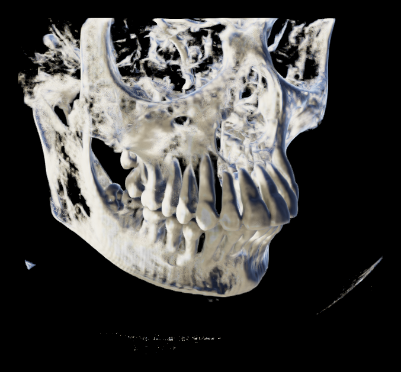
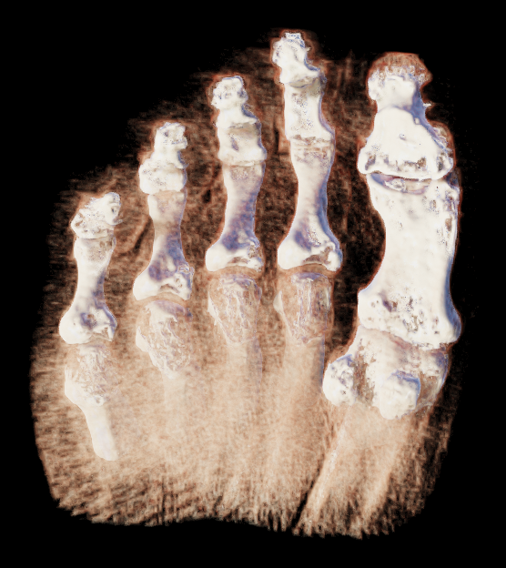
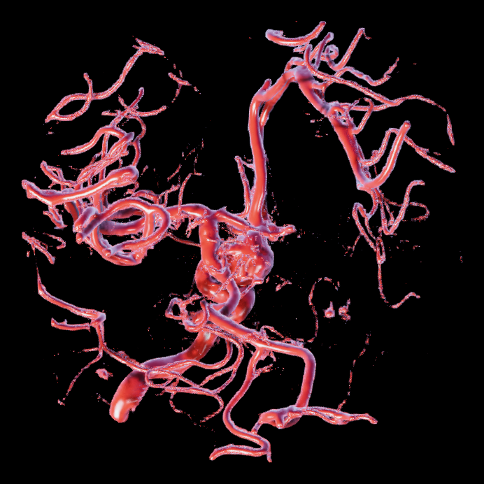

# Style Transfer Functions for Illustrative Volume Rendering

An interactive volume renderer where each density range gets a lit sphere "style", so bone, leaves or steel each get
their own material. The volume lights itself with soft shadows, ambient occlusion and one bounce of indirect light.
Based on [Bruckner and Gröller](#reference).

Made with **C++20**, **OpenGL 4.3**, [Cinder](https://libcinder.org) and [Dear ImGui](https://github.com/ocornut/imgui).


| Bonsai | Skull | Foot |
|---|---|---|
|  |  |  |

| Aneurysm | Engine |
|---|---|
|  |  |

## Features

- Alpha, color and style points on one editor over the volume's histogram, saved as `.stf` files.
- Any image as a style, plus bundled ones for bone, skin, foliage, wood, soil, ceramic, vessels, steel and brass.
- Volumetric lighting, switchable against the original classic lighting.
- Style lookahead and a crop box for materials that share densities.
- 8 and 16 bit raw volumes, ACES tone mapping and FXAA.


How it all works, with the lighting model and the command line options: [docs/implementation.md](docs/implementation.md).

## Building

Windows, Visual Studio 2026 with the *Desktop development with C++* workload, and a GPU with OpenGL 4.3.

```bash
git clone -c core.longpaths=true --recurse-submodules https://github.com/jose-villegas/StyleTransferFunction.git
```

Open `VolumeStyleRendering.sln` and build `Release|x64`. Cinder is a submodule and builds with the solution.

## Usage

*File → Open* loads a raw volume. The *Volume* menu opens the tool windows. Drag to orbit, scroll to zoom.

The bundled volumes load with a tuned transfer function from the command line:

```bash
cd VolumeStyleRendering && ../x64/Release/VolumeStyleRendering.exe --preset bonsai --ui
```

## Datasets

From the [Open SciVis Datasets](https://klacansky.com/open-scivis-datasets/) collection:

- Bonsai: CT scan of a bonsai tree, S. Roettger, VIS, University of Stuttgart.
- Skull: rotational C-arm x-ray scan of a phantom of a human skull, Siemens Medical Solutions, Forchheim, Germany.
- Foot: rotational C-arm x-ray scan of a human foot, Philips Research, Hamburg, Germany.
- Aneurysm: rotational C-arm x-ray scan of the arteries of the right half of a human head, Philips Research, Hamburg,
  Germany.
- Engine: CT scan of two cylinders of an engine block, General Electric, USA.

## Reference

Stefan Bruckner and M. Eduard Gröller. *Style Transfer Functions for Illustrative Volume Rendering.* Computer
Graphics Forum 26(3), 715–724, 2007.
