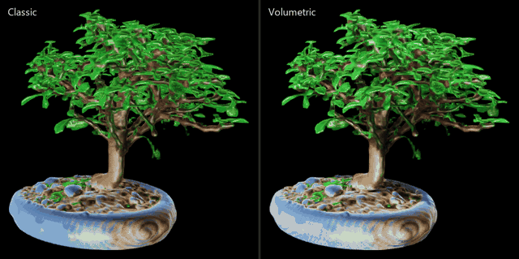
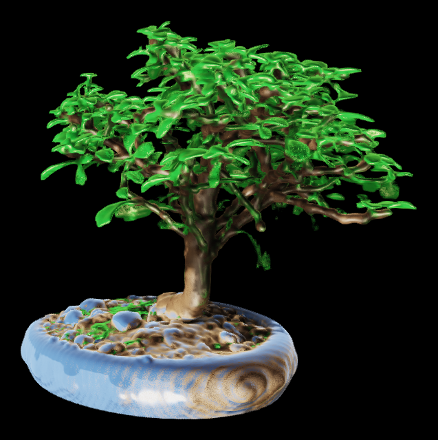
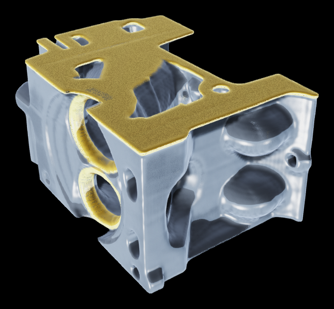
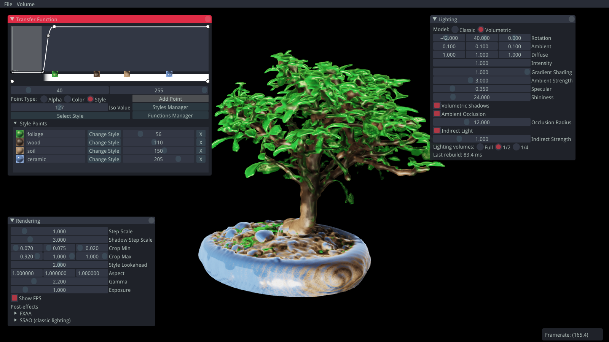
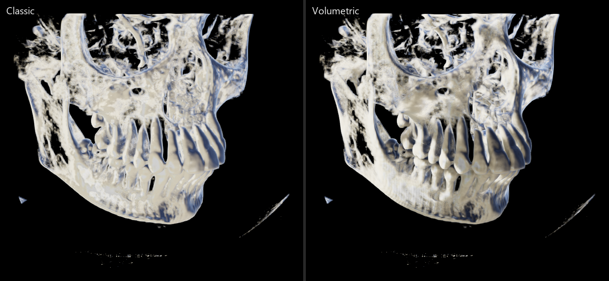
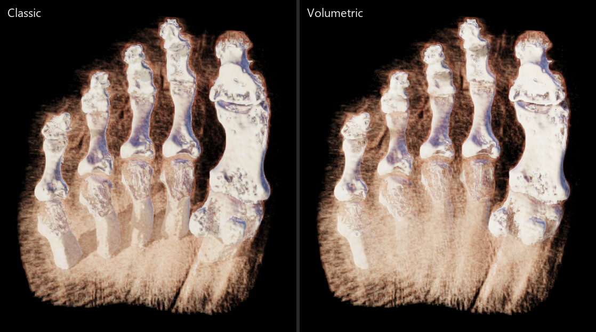

# Style Transfer Functions for Illustrative Volume Rendering

An interactive volume renderer that implements *style transfer functions* (Bruckner and Gröller, see [Reference](#reference)). Each density range picks a
lit sphere (a "style") as well as a color and opacity. Rays cast through the volume shade every sample by looking up its normal in that sphere. Lighting comes
from the volume itself: soft shadows, ambient occlusion and one bounce of indirect light, computed on the GPU and
kept in step with the transfer function.

Made with **C++20**, **OpenGL 4.3**, [Cinder](https://libcinder.org) and [Dear ImGui](https://github.com/ocornut/imgui).



| Bonsai | Skull | Foot |
|---|---|---|
|  |  |  |

| Aneurysm | Engine |
|---|---|
|  |  |

## Features

- **Style transfer functions.** Alpha, color and style control points on one editor over the volume's histogram.
  Styles are lit sphere images; any image can be added from the *Styles Manager*. Functions save to and load from
  `.stf` files. The bundled styles (bone, skin, foliage, wood, soil, ceramic, vessel, steel and brass) are painted by
  `tools/make_styles.py`.
- **Style lookahead.** The edge of a dense material passes through the densities of thinner ones, so its rim takes
  their style. The style can be looked up a few voxels behind the boundary instead, set in the *Rendering* window.
- **Crop box** in the *Rendering* window, to cut away parts of a volume that share densities with the subject.
- **Ray casting** of 8 and 16 bit raw volumes with jittered start positions, opacity correction for the step size,
  early ray termination and per axis aspect ratios.
- **Gradients** from central differences, smoothed by a separable 5×5×5 binomial filter in compute shaders. Their
  magnitude is kept, so shading can tell surfaces from homogeneous regions.
- **Volumetric lighting** (the default), see below, switchable against the original *classic* lighting in the
  *Lighting* window.
- **Post-processing:** ACES tone mapping, gamma, exposure and FXAA. Classic lighting also has screen space ambient occlusion and
  screen space shadows.



## Lighting

Classic lighting is Lambert plus a constant ambient term, with shadows and ambient occlusion computed on the final
image in screen space. It only sees the first surface a ray hits, so every inner structure is lit as if nothing stood
between it and the light.

Volumetric lighting computes light inside the volume, so whatever stands in front blocks it, at any depth.





Two 3D textures, built by compute shaders at half the volume resolution by default:

**Light volume.** Transmittance toward the directional light, marched from every voxel through the classified
volume:

```math
T_l(\mathbf{x}) = \prod_i \left(1 - \alpha(\mathbf{x} + i\,\Delta\mathbf{l})\right)
```

**Ambient volume.** Every voxel marches 16 short rays (Fibonacci sphere directions, 12 voxels long by default).
The fraction of rays that escape is the ambient visibility $`V`$. The material each ray runs into, lit by the light
volume, is reflected back as one bounce of indirect light $`E`$:

```math
V(\mathbf{x}) = \frac{1}{16} \sum_{d=1}^{16} T_d, \qquad
E(\mathbf{x}) = \frac{1}{16} \sum_{d=1}^{16} \sum_i T_{d,i}\, \alpha_i\, \mathbf{c}_i\, T_l(\mathbf{x}_i)
```

Each sample along a view ray then combines them with its style color $`\mathbf{c}`$:

```math
L = \mathbf{c} \left[ L_d \left( \left(1 - s + s\,\max(0, \mathbf{n}\cdot\mathbf{l})\right) T_l + E \right) + k_a L_a \min(2V, 1) \right]
  + L_d\, s\, k_s \frac{p + 8}{8\pi} \max(0, \mathbf{n}\cdot\mathbf{h})^p\, T_l
```

$`s`$ fades from 1 on surfaces to 0 in homogeneous regions, following the gradient magnitude. Where the normal is only
noise, samples scatter light like a medium instead of shading as a surface. A point on an open, flat surface sees half
of the sphere blocked, hence $`\min(2V, 1)`$.

The two volumes are rebuilt only when the light, the volume's rotation, the threshold or the transfer function
change. Moving the camera costs nothing extra. Every term has its own toggle and strength in the *Lighting* window,
and the window reports how long the last rebuild took.

On an AMD Radeon 610M (integrated) at 1280×720, the skull renders at about 34 ms per frame with volumetric lighting
and 87 ms with classic lighting, whose screen space shadows march a second ray per pixel. A rebuild of both lighting
volumes for a 256³ volume takes about 95 ms at half resolution.

## Building

Requires Windows, Visual Studio 2026 with the *Desktop development with C++* workload (toolset v145, Windows 10/11
SDK) and a GPU with OpenGL 4.3.

```bash
git clone -c core.longpaths=true --recurse-submodules https://github.com/jose-villegas/StyleTransferFunction.git
```

Open `VolumeStyleRendering.sln` and build `Release|x64` or `Debug|x64`. Cinder is a submodule and builds with the
solution, which takes a few minutes the first time. `Directory.Build.props` selects the v145 toolset for every
project.

## Usage

*File → Open* loads a raw volume: give its dimensions, aspect ratio and bit depth. The *Volume* menu opens the
transfer function, lighting, rendering and rotation windows. Drag to orbit, scroll to zoom.

Five volumes are in `volumes/`. A command line harness loads them with a tuned transfer function, and also
drives captures and smoke tests. Without arguments the app starts empty as before.

```bash
cd VolumeStyleRendering && ../x64/Release/VolumeStyleRendering.exe --preset skull --lighting classic
```

| Option | Effect |
|---|---|
| `--preset bonsai\|skull\|foot\|aneurism\|engine` | load a bundled volume with its transfer function and framing |
| `--volume <raw> --dims X,Y,Z` | load any raw volume, with `--16bit` and `--aspect X,Y,Z` |
| `--lighting classic\|volumetric` | lighting model |
| `--off shadows\|occlusion\|indirect\|specular\|gradient` | turn one volumetric term off, repeatable |
| `--light RX,RY,RZ`, `--intensity I`, `--ambient A` | light rotation in degrees, intensity, ambient strength |
| `--rotate RX,RY,RZ`, `--threshold MIN,MAX` | volume rotation, iso value range |
| `--crop X,Y,Z,X,Y,Z` | crop box minimum and maximum, 0 to 1 per axis |
| `--camera YAW,PITCH,DISTANCE` | orbit camera position |
| `--size W,H`, `--ui`, `--no-ui` | window size, open the tool windows, hide every window |
| `--frames N`, `--warmup N`, `--capture <dir>` | render N frames after warm up, save each as a png, then quit |
| `--orbit D`, `--light-orbit D`, `--compare N` | animate camera or light by D degrees per frame, switch models every N frames |

## Datasets

From the [Open SciVis Datasets](https://klacansky.com/open-scivis-datasets/) collection:

- Bonsai: CT scan of a bonsai tree, S. Roettger, VIS, University of Stuttgart.
- Foot: rotational C-arm x-ray scan of a human foot, Philips Research, Hamburg, Germany.
- Skull: rotational C-arm x-ray scan of a phantom of a human skull, Siemens Medical Solutions, Forchheim, Germany.
- Aneurysm: rotational C-arm x-ray scan of the arteries of the right half of a human head, with a contrast agent
  and an aneurysm, Philips Research, Hamburg, Germany.
- Engine: CT scan of two cylinders of an engine block, General Electric, USA.

## Reference

Stefan Bruckner and M. Eduard Gröller. *Style Transfer Functions for Illustrative Volume Rendering.* Computer
Graphics Forum 26(3), 715–724, 2007.
