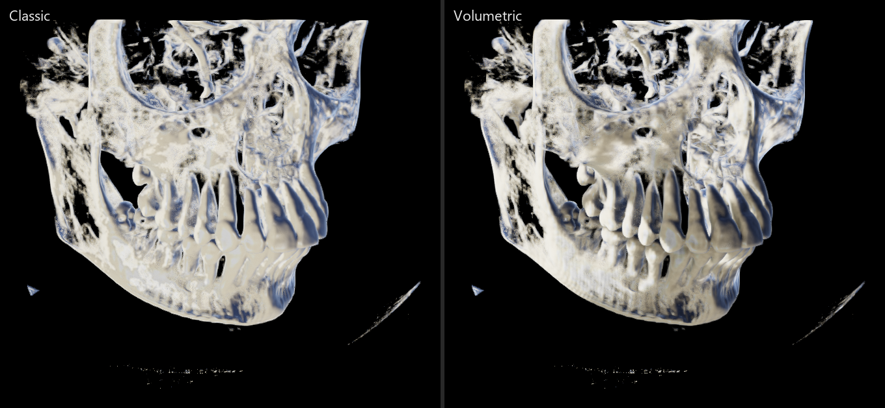
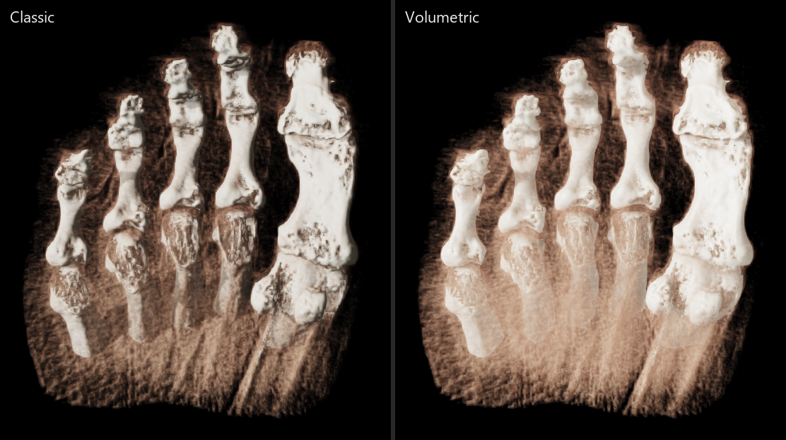

# How it works

## Style transfer functions

The editor places alpha, color and style control points over the volume's histogram. Alpha and color are interpolated
by cubic splines into a 1D texture. Style points become two more lookups: a transfer texture gives each density a
fractional index between two neighbouring style points, and an index texture maps that to a layer of a 2D array
texture holding the lit sphere images.

Every sample looks up its two styles by its view space normal reflected off the view vector, and blends them by the
fractional index. The lit sphere images are sRGB, so they are linearized before lighting and tone mapping. A lit
sphere already holds the directional shading and highlight of its material, so styled samples skip the Lambert and
specular terms and keep only shadows, occlusion and indirect light.

The bundled styles are painted by `tools/make_styles.py`: a firm terminator from the lit color into a tinted
shadow, a rim, key and secondary highlights and, for metals and glazes, a reflected horizon.

**Style lookahead.** The edge of a dense material passes through the densities of every thinner one, so a ray first
meets a pot's rim at the density of leaves. With a lookahead of N voxels, the style is looked up at the density N
voxels behind the boundary, against the normal, while opacity still follows the sample itself.

**Crop box.** Samples outside a box in texture coordinates are skipped, for parts that share densities with the
subject, like the plate under the bonsai.

## Ray casting

Rays run from the front to the back faces of the volume's bounding box, rendered as positions into two textures.
Start positions are jittered by a noise texture to hide banding, opacity is corrected for the step size and rays stop
early once nearly opaque. 8 and 16 bit raw volumes are supported, with per axis aspect ratios.

Gradients are central differences, smoothed by a separable 5×5×5 binomial filter in compute shaders. Their magnitude
is kept, so shading can tell surfaces from homogeneous regions.

## Lighting

Classic lighting is Lambert plus a constant ambient term, with shadows and ambient occlusion computed on the final
image in screen space. It only sees the first surface a ray hits, so every inner structure is lit as if nothing stood
between it and the light.

Volumetric lighting computes light inside the volume, so whatever stands in front blocks it, at any depth.





Two 3D textures, built by compute shaders at half the volume resolution by default:

**Light volume.** Transmittance toward the directional light, marched from every voxel through the classified
volume:

```math
T_l(\mathbf{x}) = \prod_i \left(1 - \alpha(\mathbf{x} + i\,\Delta\mathbf{l})\right)
```

**Ambient volume.** Every voxel marches 16 short rays (Fibonacci sphere directions, 12 voxels long by default).
The fraction of rays that escape is the ambient visibility $`V`$. The material each ray runs into, lit by the light
volume, is reflected back as one bounce of indirect light $`E`$:

```math
V(\mathbf{x}) = \frac{1}{16} \sum_{d=1}^{16} T_d, \qquad
E(\mathbf{x}) = \frac{1}{16} \sum_{d=1}^{16} \sum_i T_{d,i}\, \alpha_i\, \mathbf{c}_i\, T_l(\mathbf{x}_i)
```

Each sample along a view ray then combines them with its style color $`\mathbf{c}`$:

```math
L = \mathbf{c} \left[ L_d \left( \left(1 - s + s\,\max(0, \mathbf{n}\cdot\mathbf{l})\right) T_l + E \right) + k_a L_a \min(2V, 1) \right]
  + L_d\, s\, k_s \frac{p + 8}{8\pi} \max(0, \mathbf{n}\cdot\mathbf{h})^p\, T_l
```

$`s`$ fades from 1 on surfaces to 0 in homogeneous regions, following the gradient magnitude, and is 0 for styled
samples. Where the normal is only noise, samples scatter light like a medium instead of shading as a surface. A point
on an open, flat surface sees half of the sphere blocked, hence $`\min(2V, 1)`$.

The two volumes are rebuilt only when the light, the volume's rotation, the threshold or the transfer function
change. Moving the camera costs nothing extra. Every term has its own toggle and strength in the *Lighting* window,
and the window reports how long the last rebuild took.

On an AMD Radeon 610M (integrated) at 1280×720, the skull renders at about 34 ms per frame with volumetric lighting
and 87 ms with classic lighting, whose screen space shadows march a second ray per pixel. A rebuild of both lighting
volumes for a 256³ volume takes about 95 ms at half resolution.

## Command line harness

Opt-in, for presets, captures and smoke tests. Without arguments the app starts empty.

| Option | Effect |
|---|---|
| `--preset bonsai\|skull\|foot\|aneurism\|engine` | load a bundled volume with its transfer function and framing |
| `--volume <raw> --dims X,Y,Z` | load any raw volume, with `--16bit` and `--aspect X,Y,Z` |
| `--lighting classic\|volumetric` | lighting model |
| `--off shadows\|occlusion\|indirect\|specular\|gradient` | turn one volumetric term off, repeatable |
| `--light RX,RY,RZ`, `--intensity I`, `--ambient A` | light rotation in degrees, intensity, ambient strength |
| `--rotate RX,RY,RZ`, `--threshold MIN,MAX` | volume rotation, iso value range |
| `--crop X,Y,Z,X,Y,Z` | crop box minimum and maximum, 0 to 1 per axis |
| `--camera YAW,PITCH,DISTANCE` | orbit camera position |
| `--size W,H`, `--ui`, `--no-ui` | window size, open the tool windows, hide every window |
| `--frames N`, `--warmup N`, `--capture <dir>` | render N frames after warm up, save each as a png, then quit |
| `--orbit D`, `--light-orbit D`, `--compare N` | animate camera or light by D degrees per frame, switch models every N frames |
